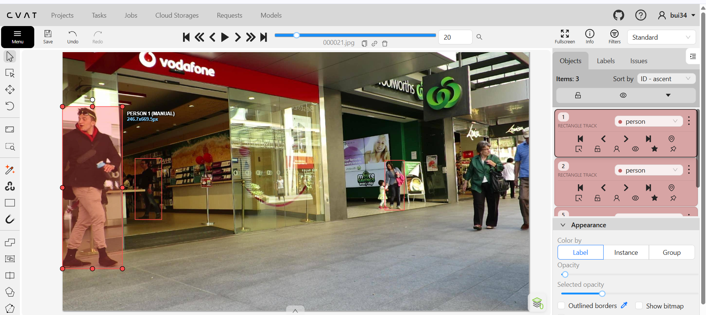
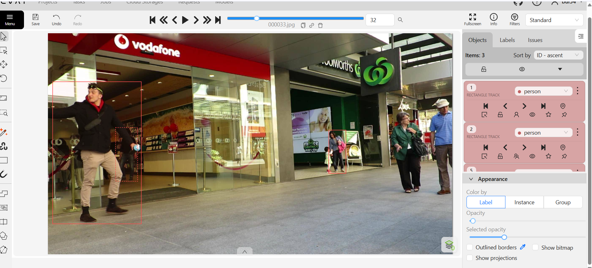
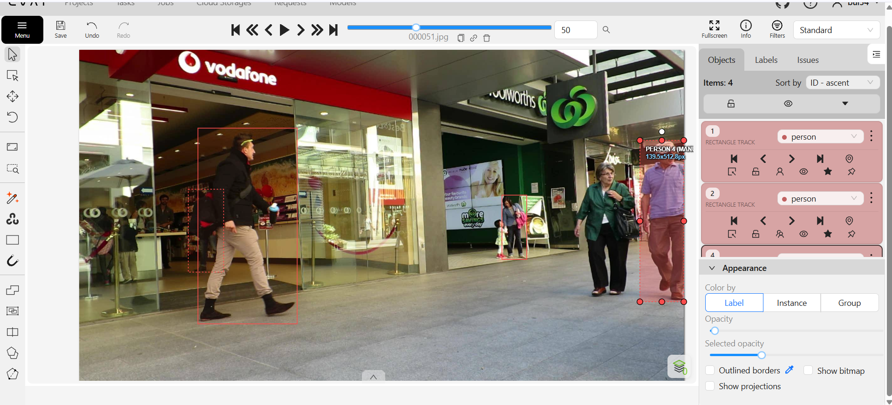

# Báo cáo cá nhân — BuiQuocBinh-2A202603260

Đổi tên file theo quy tắc `MSSV_HoTen.md`. Ví dụ: `20241234_NguyenVanAn.md`.

Đoạn video: MOT17-09, 150 frame (frame 1–150), nguồn MOTChallenge (Milan et al., 2016), giấy phép CC BY-NC-SA 3.0.

## 0. Thông tin học viên

- Họ tên: Bùi Quốc Bình
- MSSV: 2A202603260
- Mã đề (A/B/C): C
- Email: 26ai.binhbq@vinuni.edu.vn
- Link repository: https://github.com/binhbui8112004/K5-L2-DAY05-BuiQuocBinh-2A202603260-MOTTracking
- Giờ bắt đầu: 16:30
- Giờ kết thúc: 19:20
- Ghi chú môi trường: Máy cá nhân không chạy được Docker nên thực hiện tạo task thủ công và gán nhãn trên CVAT Online với đúng 150 frame MOT17-09.

## 1. Xem trước đoạn video (CP0)

Ghi **trước khi vẽ**, mỗi người một dòng (số frame theo CVAT từ 0 đến 149).

| Mã  | Object ID trên CVAT | Frame xuất hiện | Frame cuối thấy được | Rẽ / dừng / đổi tốc độ ở frame                     | Bị che ở frame                                                       | Ghi chú                                                |
| --- | ------------------: | --------------: | -------------------: | -------------------------------------------------- | -------------------------------------------------------------------- | ------------------------------------------------------ |
| P1  |  Track 2 (XML id=1) |               0 |                  149 | 30–60 (đi ngang trong shop), 110–149 (tiến ra cửa) | 0–19 (cửa kính/quầy), 30–39 & 50–59 (`occluded`), 40–49 (`outside`)  | Người đi bên trong cửa hàng Vodafone                   |
| P2  |  Track 3 (XML id=2) |              61 |                  149 | 70–90, 120–140                                     | 61–79 (khuất một phần trong cửa hàng)                                | Xuất hiện từ bên trong cửa hàng Vodafone ở frame 61    |
| P3  |  Track 4 (XML id=3) |              39 |                  149 | 70–149 (tiến lại gần camera, box lớn dần nhanh)    | 39–69 (mép phải khung hình / người đi trước)                         | Người đàn ông áo xanh đội mũ đi từ bên phải vào        |
| P4  |  Track 5 (XML id=4) |               2 |                  109 | 40–80 (đi chậm gần cửa), 90–109 (đi vào đám đông)  | 90–109 (`occluded`), từ 110 bị đám đông che khuất hẳn (`outside`)    | Người phụ nữ đeo túi hồng đi ở giữa hành lang          |
| P5  |  Track 1 (XML id=0) |               0 |                  139 | 30–50 (bước nhanh ngang qua cửa shop), 79–90       | 120–129 (`outside` tạm thời), 130–139 (`occluded`), từ 140 khuất hẳn | Chàng trai áo khoác đen quần kaki đi từ trái sang phải |

## 2. Keyframe và thời gian (CP1, CP4)

Số keyframe lấy từ kết quả `src/check_submission.py`.

| Mã       | Object ID (CVAT) | Số keyframe | Keyframe ở frame                                                    | Số frame có mặt | Keyframe / 100 frame | Thời gian (phút) | Chỗ khó                                                                               |
| -------- | ---------------: | ----------: | ------------------------------------------------------------------- | --------------: | -------------------: | ---------------: | ------------------------------------------------------------------------------------- |
| P1       |  Track 2 (XML 1) |          15 | `[0, 10, 20, 30, 50, 60, 70, 80, 90, 100, 110, 120, 130, 140, 149]` |             140 |                 10.7 |               15 | Đi phía sau lớp kính cửa hàng Vodafone, bị P5 che một phần (30–39) và che hẳn (40–49) |
| P2       |  Track 3 (XML 2) |          10 | `[61, 70, 80, 90, 100, 110, 120, 130, 140, 149]`                    |              89 |                 11.2 |                8 | Mới xuất hiện ở frame 61 bên trong cửa hàng tối, dễ nhầm với bóng phản chiếu          |
| P3       |  Track 4 (XML 3) |          12 | `[39, 50, 60, 70, 80, 90, 100, 110, 120, 130, 140, 149]`            |             111 |                 10.8 |               10 | Đi tiến về phía camera làm kích thước bounding box thay đổi liên tục                  |
| P4       |  Track 5 (XML 4) |           9 | `[2, 10, 20, 40, 50, 60, 80, 90, 100]`                              |             108 |                  8.3 |               10 | Đi ở xa và bị nhóm người đi bộ phía trước che khuất dần từ frame 90 đến khi khuất hẳn |
| P5       |  Track 1 (XML 0) |          14 | `[0, 10, 20, 30, 40, 50, 60, 70, 79, 80, 90, 100, 110, 130]`        |             130 |                 10.8 |               12 | Di chuyển ngang gần camera với sải chân rộng, cuối đoạn đi lẫn vào đám đông bên phải  |
| **Tổng** |                  |      **60** |                                                                     |         **578** |             **10.4** |           **55** |                                                                                       |

Keyframe / 100 frame của cả bài = tổng keyframe ÷ tổng số frame có mặt × 100 = `60 ÷ 578 × 100 = 10.4` keyframe / 100 frame.

Bạn đặt keyframe nhiều nhất ở người nào? Vì sao (người đó rẽ, dừng, lại gần camera hay bị che)?

- Đặt nhiều keyframe nhất ở **P1** (**15 keyframe** trên 140 frame có mặt) và **P5** (**14 keyframe** trên 130 frame có mặt):
  - Với **P1**: có mặt từ đầu đến cuối chuỗi video, di chuyển bên trong cửa hàng và trải qua giai đoạn bị P5 che khuất một phần (frame 30–39), khuất hoàn toàn phải bật `outside` (frame 40–49) rồi hiện lại ở frame 50 nên cần đặt keyframe chặn hai đầu đoạn che để giữ đúng quỹ đạo và kích thước amodal box.
  - Với **P5**: đi cắt ngang từ sát mép trái sang phải ở cự ly gần camera, sải bước dài làm bề rộng box thay đổi theo nhịp bước chân, đặc biệt đoạn frame 79–80 cần đặt sát keyframe để nắn lại độ khít của box và đoạn cuối (120–139) bị che khuất trong đám đông.

## 3. Đoạn bị che (CP2)

Người bị che: `P1` (Object ID 2 trên CVAT)

| Mốc                                      | Frame |
| ---------------------------------------- | ----: |
| Bắt đầu bị che một phần (bật `occluded`) |    30 |
| Mất hẳn (bật `outside`)                  |    40 |
| Hiện lại (tắt `outside`)                 |    50 |
| Thấy rõ trở lại (tắt `occluded`)         |    60 |

- Thời gian khuất hẳn: `10` frame (từ frame 40 đến hết frame 49) = `0.33` giây (tổng thời gian bị che một phần và toàn phần từ frame 30 đến 59 là 30 frame = 1.0 giây).
- Quyết định: **Giữ cùng ID** (Object ID 2).
- Lý do (trả lời 3 câu: khuất bao lâu so với 60 frame, ngoại hình có khớp, chỗ hiện lại có đúng hướng và tốc độ):
  1. **Thời gian khuất so với ngưỡng 60 frame:** Thời gian bị che khuất hoàn toàn (10 frame = 0.33 giây) nhỏ hơn rất nhiều so với ngưỡng quy ước 60 frame (2 giây) của lớp.
  2. **Ngoại hình:** Khi lộ diện trở lại ở frame 50 sau lưng P5, đối tượng vẫn mặc đúng trang phục tối màu và vóc dáng của P1 bên trong cửa hàng Vodafone.
  3. **Hướng đi và tốc độ:** Vị trí P1 hiện lại ở frame 50 hoàn toàn khớp với quỹ đạo và vận tốc đi bộ từ trái sang phải của P1 trước khi bị che ở frame 30–39.

Ảnh chụp màn hình (Nguồn ảnh gốc: MOT17, MOTChallenge — Milan et al., 2016):





## 4. Tự review ID (CP3)

Lượt 1 theo người (đi ngược từ frame 149 về 0 trên CVAT), lượt 2 theo cảnh (nhảy 10 frame). Ít nhất 3 dòng; không có lỗi thì ghi một dòng "đã kiểm hai lượt, không lỗi".

Loại lỗi dùng đúng một trong 7 mã: `id_switch`, `fragmentation`, `lost`, `merge`, `false_track`, `drift`, `flag`.

| Frame | Mã người | Loại lỗi | Mô tả một câu                                                                                  | Phát hiện ở lượt | Đã sửa? |
| ----: | -------- | -------- | ---------------------------------------------------------------------------------------------- | ---------------- | ------- |
|    79 | P5       | `drift`  | Box nội suy bị lệch nhẹ theo sải chân rộng của P5 nên em chèn thêm keyframe ở frame 79         | Lượt 1           | Có      |
|    40 | P1       | `flag`   | P1 bị lưng P5 che lấp 100% từ frame 40–49 nhưng ban đầu quên bật `outside`, đã bật bổ sung     | Lượt 1           | Có      |
|   120 | P5       | `flag`   | P5 và P4 đi vào đám đông ở cuối video bị khuất hẳn, đã rà soát lại để bật `outside`/`occluded` | Lượt 2           | Có      |

Tổng hợp số lỗi theo loại:

| `id_switch` | `fragmentation` | `lost` | `merge` | `false_track` | `drift` | `flag` |
| ----------: | --------------: | -----: | ------: | ------------: | ------: | -----: |
|           0 |               0 |      0 |       0 |             0 |       1 |      2 |

Lỗi nào chỉ lượt 2 (theo cảnh) mới thấy, lượt 1 (theo người) không thấy? Vì sao?

- Ở lượt 1 khi chỉ nhìn tập trung vào một người và tua ngược, em dễ bỏ sót việc người đó đang bị người khác đi cắt qua che khuất. Sang lượt 2 nhìn toàn cảnh cả 5 box cùng lúc thì em mới thấy rõ sự tương tác ở các đoạn nhiều người giao nhau (như đoạn P1 bị P5 chắn ngang ở frame 30–50 hay đoạn đám đông từ frame 90–140 của P4, P5) để bật đủ cờ `occluded`/`outside` (`flag`) và kiểm tra không bị gộp box (`merge`) hay nhảy nhầm ID (`id_switch`).

## 5. File xuất và kết quả tự kiểm (CP4)

| Kiểm tra                                                  | Kết quả                                  |
| --------------------------------------------------------- | ---------------------------------------- |
| Tên file MOT 1.1                                          | `src/exports/BuiQuocBinh_mot.zip`        |
| Tên file CVAT for video 1.1                               | `src/exports/BuiQuocBinh_cvat_video.zip` |
| Số track ID khác nhau trong `gt/gt.txt` (phải là 5)       | 5                                        |
| Frame `outside` không có dòng trong `gt.txt` (đúng / sai) | Đúng                                     |
| Job đã completed trên CVAT                                | Đã completed                             |

Dán phần tóm tắt in ra từ `src/check_submission.py`:

```text
Số frame in theo CVAT (bắt đầu từ 0). Trong gt.txt, frame_id = frame CVAT + 1.

=== File MOT 1.1: BuiQuocBinh_mot.zip ===
  Số track ID: 5   |   Tổng số box: 578
  [OK]        Đúng 5 track ID.

  Track | Frame có mặt | Số frame | Đoạn vắng (outside)
      1 |   0–139      |      130 | 120–129
      2 |   0–149      |      140 | 40–49
      3 |   2–109      |      108 | -
      4 |  39–149      |      111 | -
      5 |  61–149      |       89 | -


=== File CVAT for video 1.1: BuiQuocBinh_cvat_video.zip ===

  Track | Nhãn   | Frame thấy | Keyframe | KF/100 frame | Frame occluded | Lần bật outside
      0 | person |        130 |       14 |         10.8 |             10 |               2
              Track 0: keyframe ở frame [0, 10, 20, 30, 40, 50, 60, 70, 79, 80, 90, 100, 110, 130]
      1 | person |        140 |       15 |         10.7 |             40 |               1
              Track 1: keyframe ở frame [0, 10, 20, 30, 50, 60, 70, 80, 90, 100, 110, 120, 130, 140, 149]
      2 | person |         89 |       10 |         11.2 |             19 |               0
              Track 2: keyframe ở frame [61, 70, 80, 90, 100, 110, 120, 130, 140, 149]
      3 | person |        111 |       12 |         10.8 |             31 |               0
              Track 3: keyframe ở frame [39, 50, 60, 70, 80, 90, 100, 110, 120, 130, 140, 149]
      4 | person |        108 |        9 |          8.3 |             20 |               1
              Track 4: keyframe ở frame [2, 10, 20, 40, 50, 60, 80, 90, 100]

  Tổng: 60 keyframe / 578 frame có mặt = 10.4 keyframe / 100 frame
  [OK]        Đọc được 5 track từ annotations.xml.

=== Tóm tắt ===
  Lỗi: 0   |   Cảnh báo: 0
  Đạt. Dán phần tóm tắt này vào báo cáo mục 5.
```

## 6. Ba câu kết

1. Nếu được gán lại, bạn sẽ đặt keyframe khác ở đâu? Vì sao?
   - Thay vì đặt đều mỗi 10 frame bằng phím `V` ở cả những đoạn người đi thẳng đều (như đoạn giữa của P3 và P4), em sẽ giảm bớt keyframe ở đoạn đi thẳng và tập trung cắm keyframe sát ngay tại frame bắt đầu/kết thúc bị che khuất (như quanh frame 30, 40, 50 của P1) hoặc lúc người đổi tốc độ để box vừa khít vừa đỡ tốn thao tác.

2. Có chỗ nào bạn không chắc "cùng ID hay ID mới"? Bạn đã quyết định và ghi chú thế nào?
   - Chỗ làm em phân vân nhất là lúc P1 đi bên trong cửa hàng Vodafone bị P5 đi ngang qua che khuất hoàn toàn từ frame 40 đến 49, và lúc P2 mới xuất hiện ở frame 61 cũng ngay trong cửa hàng đó (ban đầu nhìn qua lớp kính hơi tối dễ nhầm hai người hoặc tưởng P1 đổi hướng). Em đã đối chiếu lại bảng nhận diện, thấy P1 chỉ bị khuất hẳn đúng 10 frame (nhỏ hơn nhiều so với ngưỡng 60 frame), khi hiện lại ở frame 50 thì quần áo và hướng đi từ trái sang phải vẫn khớp nên em tắt `outside` giữ nguyên ID cũ cho P1, còn P2 xuất hiện ở frame 61 thì tạo track riêng.

3. Một lỗi ID trong job của bạn (nếu không còn sót, chọn lỗi đã sửa) có thể làm xe tự lái dự đoán sai chuyển động của người đó như thế nào? Lỗi đó ảnh hưởng MOTA hay IDF1 nhiều hơn?
   - Nếu ở đoạn P1 và P5 cắt ngang nhau (quanh frame 30–50) mà bị `id_switch` (ID của P1 nhảy sang P5), hệ thống xe tự lái sẽ tưởng người đang đi chậm trong cửa hàng bỗng nhiên nhảy vọt ra ngoài hành lang với vận tốc rất lớn chỉ trong 1–2 frame, dẫn đến dự đoán sai quỹ đạo và phanh gấp không cần thiết. Lỗi đổi ID này ảnh hưởng nặng đến **IDF1** hơn nhiều so với **MOTA**, vì MOTA chỉ trừ lỗi tại đúng 1 frame xảy ra switch, còn IDF1 phạt toàn bộ số frame sau đó do track không còn giữ đúng một định danh duy nhất từ đầu đến cuối.

## 7. Tài liệu tham khảo và công cụ AI đã dùng

- Bộ dữ liệu: MOT17-09, MOTChallenge (Milan et al., 2016), giấy phép CC BY-NC-SA 3.0.
- Công cụ gán nhãn: CVAT Online (Computer Vision Annotation Tool).
